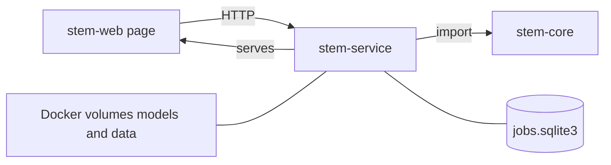

# Architecture overview

> Living document. Reflects current system state.

Last updated: 0000016-docker-packaging

## System summary

Music Stems is a self-hosted service that splits a mix into stems. The repo holds a Python project with three components. A CI job lints and tests them and builds a Docker image. `stem-core` holds the two-pass `split()` function and the `stems` command. `stem-service` holds the job store, the worker, and the HTTP API. `stem-web` holds the page that the API serves.

## Components

| Component | Type | Purpose | Status |
|-----------|------|---------|--------|
| stem-core | component-pack | The two-pass separation function and the `stems` command | active (`split()` and the `stems` command built) |
| stem-service | microservice | The job store, the worker, the HTTP API, and the Docker image | active (job store, worker, HTTP API, and Docker files built) |
| stem-web | microfrontend | The web page that the API serves | active (page built) |

## Communication patterns

## Data ownership

| Data | Owner | Where |
|------|-------|-------|
| `jobs` table | stem-service | `STEMS_DATA_DIR/jobs.sqlite3` |
| Uploaded files | stem-service | `STEMS_DATA_DIR/uploads` |
| Docker volumes `data` and `models` | stem-service | `/data` and `/models` in the container |

## External dependencies

| Dependency | Type | Components that use it |
|-----------|------|----------------------|
| pytest | PyPI, development | stem-core, stem-service, stem-web |
| ruff | PyPI, development | stem-core, stem-service, stem-web |
| audio-separator[cpu]==0.48.0 | PyPI, runtime, `separation` extra | stem-core |
| fastapi, uvicorn, python-multipart | PyPI, runtime, `service` extra | stem-service |
| httpx | PyPI, development | stem-service, stem-web |
| python:3.12-slim and ffmpeg | Docker base image and Debian package, runtime | stem-service |
| audio-separator[gpu] | PyPI, runtime, selected by `STEMS_EXTRA=gpu` | stem-service |

## Key architectural decisions

- ADR-0001: One root `pyproject.toml` with `pytest` and `ruff` serves all components.
- ADR-0002: `split()` takes an injectable separator factory, imports `audio_separator` late, and installs it from a pinned `separation` extra.
- ADR-0003: The `stems` command uses `argparse` with injectable probes, and a console script installs it from the packaged `stem_core`.
- ADR-0004: `stem-service` owns a SQLite `jobs` table. One worker thread for each device runs jobs through a pool that loads each model once.
- ADR-0005: `stem-service` serves a FastAPI app on `127.0.0.1` with no login. A stem request resolves only against a job's stored outputs.
- ADR-0006: `stem-web` holds a build-free HTML, CSS, and JavaScript page. `stem-service` serves it at `/` and under `/static`.
- ADR-0007: `stem-core` holds the allowlists for the model options and checks them first. The command, the API, and the worker all call that check, so no model loads for a bad value.
- ADR-0008: `stem-service` owns one `Dockerfile` and two compose files. The container binds to all interfaces, and compose publishes on `127.0.0.1` only. Two named volumes keep the models and the jobs.
