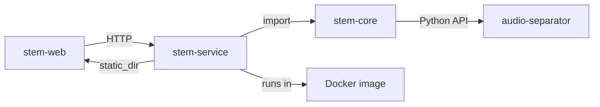

# Dependency graph

> Living document. Reflects current system state.

Last updated: 0000016-docker-packaging

`stem-core` calls `audio-separator`. The `stems` command calls `split()` inside `stem-core`. `stem-service` imports `split()` from `stem-core` through its worker, and serves an HTTP API. It also serves the web page of `stem-web`, which calls that API.

| From | To | Status |
|------|----|--------|
| stem-web | stem-service | active |
| stem-service | stem-web | active |
| stem-service | stem-core | active |
| stem-core | audio-separator | active |
| stem-service | Docker image | active |
