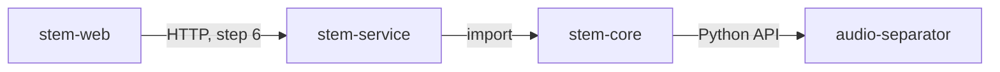

# Dependency graph

> Living document. Reflects current system state.

Last updated: 0000010-http-api

`stem-core` calls `audio-separator`. The `stems` command calls `split()` inside `stem-core`. `stem-service` imports `split()` from `stem-core` through its worker, and serves an HTTP API that the web page calls in step 6.

| From | To | Status |
|------|----|--------|
| stem-web | stem-service | planned |
| stem-service | stem-core | active |
| stem-core | audio-separator | active |
