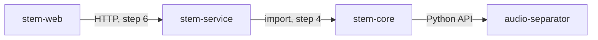

# Dependency graph

> Living document. Reflects current system state.

Last updated: 0000006-command-line-interface

`stem-core` calls `audio-separator`. The `stems` command calls `split()` inside `stem-core`. No component calls another component yet. Later steps add those edges.

| From | To | Status |
|------|----|--------|
| stem-web | stem-service | planned |
| stem-service | stem-core | planned |
| stem-core | audio-separator | active |
