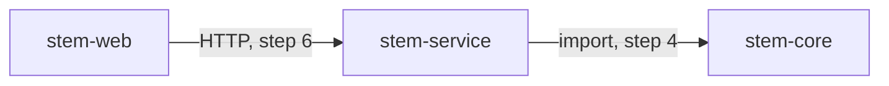

# Dependency graph

> Living document. Reflects current system state.

Last updated: 0000002-python-scaffold

The three components hold no code that calls another component yet. Later steps add these edges.

| From | To | Status |
|------|----|--------|
| stem-web | stem-service | planned |
| stem-service | stem-core | planned |
