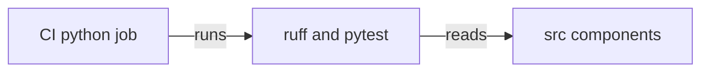

# Execution Plan - Scaffold the Python project and its CI

> Every requirement traces to a user story in the confirmed design.

**Skill:** [plan](../../ravintio-zero/skills/ravintio-plan/SKILL.md)
**Feature:** 0000002-python-scaffold
**Version:** 0.1.0
**Status:** active

## Active Skills

| Skill | Scope | Purpose |
|-------|-------|---------|
| ravintio-implement | plan | Builds each unit with tests and docs |

## Functional Requirements Directory

Functional requirements are split into individual files, one user story per file, at `plan/current/requirements/`.

| File | Requirement |
|------|------------|
| [req-001-project-layout.md](requirements/req-001-project-layout.md) | One `pyproject.toml`, three component packages, and one smoke test for each |
| [req-002-python-ci-job.md](requirements/req-002-python-ci-job.md) | A `python` CI job that lints and tests on pull requests |
| [req-003-version-record.md](requirements/req-003-version-record.md) | Three components in `product.yml`, each with a manifest and docs |

## Non-Functional Requirements

| ID | Category | Requirement | Target | Measurement |
|----|----------|------------|--------|-------------|
| NFR-001 | Reliability | The `python` job gives a correct verdict | Red when a test fails and green when all pass | A pull request check result |
| NFR-002 | Security | The `python` job holds read access only | `permissions: contents: read` | Workflow file |

## API Summary

None. The step builds no API.

## Data Model Summary

None. The step owns no data.

## Component Interactions

## Test impact

| Cause | Test | Unit |
|-------|------|------|
| Workflow job edit | `ravintio-zero/tests/test-0000327-req-002-ci-job.sh`, `test-0000317-req-001-003-004-rules-ignores-checks.sh`, `test-0000390-req-003-enforcement-points.sh`, `test-0000042-req-008-pack-prose.sh` | U3-ci |
| Backlog entry id | `ravintio-zero/tests/test-0000378-req-002-003-merge-queue.sh` references a different id only | U3-ci |
| New test file | Repo-wide style tests. Python tests live under `src/*/tests/`, outside the bash suite | U2-packages |
| Skill count, skill-text budget, size cap, reference file edit, non-suite file, fixture-pinned line | none found | none |

## Branch-point reads

| File | Commit read | Unit |
|------|-------------|------|
| `.gitignore` | `40a2869` (local) | U1-config |
| `.github/workflows/ravintio.yml` | `40a2869` (local) | U3-ci |
| `product.yml` | `f5fe1b7` (local) | U4-docs |
| `pyproject.toml` | new | U1-config |
| `src/stem-core/stem_core/__init__.py` | new | U2-packages |
| `src/stem-core/tests/test_smoke.py` | new | U2-packages |
| `src/stem-service/stem_service/__init__.py` | new | U2-packages |
| `src/stem-service/tests/test_smoke.py` | new | U2-packages |
| `src/stem-web/stem_web/__init__.py` | new | U2-packages |
| `src/stem-web/tests/test_smoke.py` | new | U2-packages |
| `src/stem-core/docs/purpose.md` and five more per-component docs | new | U4-docs |
| `src/stem-service/docs/purpose.md` and five more per-component docs | new | U4-docs |
| `src/stem-web/docs/purpose.md` and five more per-component docs | new | U4-docs |
| `docs/component-registry.md`, `docs/dependency-graph.md` | new | U4-docs |
| `docs/architecture-overview.md` | new | U4-docs |
| `docs/decisions-index.md` | new | U4-docs |

## Concurrency plan

| Unit | Depends on | Writes | Batch | Sequential reason | Shared resources |
|------|-----------|--------|-------|-------------------|------------------|
| U1-config | none | `pyproject.toml`, `.gitignore` | 1 | none | none |
| U2-packages | none | `src/stem-core/stem_core/__init__.py`, `src/stem-core/tests/test_smoke.py`, `src/stem-service/stem_service/__init__.py`, `src/stem-service/tests/test_smoke.py`, `src/stem-web/stem_web/__init__.py`, `src/stem-web/tests/test_smoke.py` | 1 | none | none |
| U3-ci | U1-config | `.github/workflows/ravintio.yml` | 2 | Reads the commands that `pyproject.toml` defines | none |
| U4-docs | U2-packages | the `docs/` set of each component, `docs/component-registry.md`, `docs/dependency-graph.md`, `docs/architecture-overview.md`, `docs/decisions-index.md`, `product.yml` | 2 | none | none |

## Assumptions

| ID | Assumption | Impact if Wrong |
|----|-----------|----------------|
| A-001 | `pytest` and `ruff` install from PyPI in CI | The job fails and the step stops |

## Open Questions

None.
