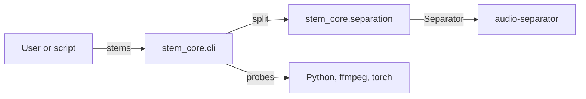

# Execution Plan - Add the command-line interface

> Every requirement traces to a user story in the confirmed design.

**Skill:** [plan](../../ravintio-zero/skills/ravintio-plan/SKILL.md)
**Feature:** 0000006-command-line-interface
**Version:** 0.3.0
**Status:** active

## Active Skills

| Skill | Scope | Purpose |
|-------|-------|---------|
| ravintio-implement | plan | Builds each unit with tests and docs |

## Functional Requirements Directory

Functional requirements are split into individual files, one user story per file, at `plan/current/requirements/`.

| File | Requirement |
|------|------------|
| [req-001-split-command.md](requirements/req-001-split-command.md) | `stems split` prints paths, and the entry points run `main()` |
| [req-002-full-stems-option.md](requirements/req-002-full-stems-option.md) | `--full-stems` adds drums, bass, and other |
| [req-003-environment-report.md](requirements/req-003-environment-report.md) | `stems env` reports Python, FFmpeg, and the device |
| [req-004-model-list.md](requirements/req-004-model-list.md) | `stems models` lists the models in use |

## Non-Functional Requirements

| ID | Category | Requirement | Target | Measurement |
|----|----------|------------|--------|-------------|
| NFR-001 | Exit codes | Success exits 0 and failure exits non-zero | One error line for each failure | Unit tests check each code and line count |
| NFR-002 | Start-up cost | `env` and `models` import no model library | `audio_separator` absent from `sys.modules` | A unit test checks it |

## API Summary

None. The step builds a command and no endpoint.

## Data Model Summary

None. The step owns no data.

## Component Interactions

## Test impact

| Cause | Test | Unit |
|-------|------|------|
| Backlog entry id | `ravintio-zero/tests/test-0000007-agent-optimisation.sh` and `test-0000199-req-001-003-reserve-ids-from-counter.sh` name `0000007` for pack reasons that do not touch this entry | U1-cli |
| New test file | `test-0000042-req-008-pack-prose.sh`, `test-0000164-req-008-no-process-substitution-loops.sh` | U1-cli |
| New tracked file | `test-0000042-req-010-pack-wording-allowlist.sh` | U3-docs |
| File edit | `src/stem-core/tests/test_pin_ci.py` reads `pyproject.toml`. The packaging edit keeps the `separation` extra and the slow marker | U2-entry |
| Skill count, skill-text budget, size cap, workflow edit, reference file edit, non-suite file, fixture-pinned line | none found | none |

## Branch-point reads

| File | Commit read | Unit |
|------|-------------|------|
| `pyproject.toml` | `c8398e0` | U2-entry |
| `src/stem-core/stem_core/__init__.py` | `c8398e0` | U1-cli |
| `src/stem-core/stem_core/separation.py` | `c8398e0` | U1-cli |
| `src/stem-core/stem_core/cli.py`, `__main__.py` | new | U1-cli |
| `src/stem-core/tests/test_cli.py` | new | U1-cli |
| `src/stem-core/tests/test_entry_points.py` | new | U2-entry |
| `src/stem-core/component.yml` | `c8398e0` | U3-docs |
| `src/stem-core/docs/` (six files) | `c8398e0` | U3-docs |
| `docs/component-registry.md`, `docs/dependency-graph.md`, `docs/architecture-overview.md`, `docs/decisions-index.md` | `c8398e0` | U3-docs |

## Concurrency plan

| Unit | Depends on | Writes | Batch | Sequential reason | Shared resources |
|------|-----------|--------|-------|-------------------|------------------|
| U1-cli | none | `src/stem-core/stem_core/cli.py`, `src/stem-core/stem_core/__main__.py`, `src/stem-core/tests/test_cli.py` | 1 | Every later unit runs the module that this unit writes | none |
| U2-entry | U1-cli | `pyproject.toml`, `src/stem-core/tests/test_entry_points.py` | 2 | The test runs the module that U1-cli writes | none |
| U3-docs | U1-cli, U2-entry | `src/stem-core/component.yml`, the `docs/` set of `stem-core`, `docs/component-registry.md`, `docs/dependency-graph.md`, `docs/architecture-overview.md`, `docs/decisions-index.md` | 3 | Describes the finished code | none |

## Assumptions

| ID | Assumption | Impact if Wrong |
|----|-----------|----------------|
| A-001 | `torch` and `ffmpeg` may be absent locally | `env` reports `cpu` and `not found` |

## Open Questions

None.
