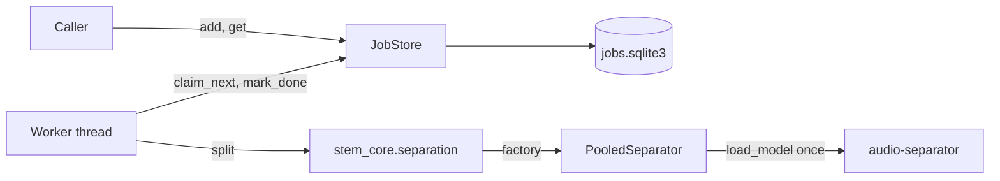

# Execution Plan - Add the job queue and worker

> Every requirement traces to a user story in the confirmed design.

**Skill:** [plan](../../ravintio-zero/skills/ravintio-plan/SKILL.md)
**Feature:** 0000008-job-queue-worker
**Version:** 0.4.0
**Status:** active

## Active Skills

| Skill | Scope | Purpose |
|-------|-------|---------|
| ravintio-implement | plan | Builds each unit with tests and docs |

## Functional Requirements Directory

Functional requirements are split into individual files, one user story per file, at `plan/current/requirements/`.

| File | Requirement |
|------|------------|
| [req-001-job-store.md](requirements/req-001-job-store.md) | Add a job, read it, claim it, and finish it |
| [req-002-restart-recovery.md](requirements/req-002-restart-recovery.md) | Jobs persist, and `recover()` requeues a `running` job |
| [req-003-worker.md](requirements/req-003-worker.md) | A worker runs jobs one at a time, and one worker runs for each device |
| [req-004-model-reuse.md](requirements/req-004-model-reuse.md) | A pool loads each model once for a worker |

## Non-Functional Requirements

| ID | Category | Requirement | Target | Measurement |
|----|----------|------------|--------|-------------|
| NFR-001 | Isolation | Two jobs never overlap on one worker | Zero overlapping run intervals | A unit test records start and end times |
| NFR-002 | Durability | A committed job survives a restart | Every job reads back from a second store | A unit test reopens the file |
| NFR-003 | Start-up cost | Importing the package loads no model library | `audio_separator` absent from `sys.modules` | A unit test checks it |

## API Summary

None. The step builds a Python API and no endpoint.

## Data Model Summary

One table, `jobs`, owned by `stem-service`. Columns: `id`, `status`, `input_path`, `full_stems`, `options`, `outputs`, `error`, `created_at`, `started_at`, `finished_at`. See `src/stem-service/docs/data-contract.md`.

## Component Interactions

## Test impact

| Cause | Test | Unit |
|-------|------|------|
| Backlog entry id | `test-0000321-req-005-default-migration.sh` and `test-0000009-rail-tightening.sh` name `0000009` for pack reasons that do not touch this entry | U1-store |
| New test file | `test-0000042-req-008-pack-prose.sh`, `test-0000164-req-008-no-process-substitution-loops.sh` | U1-store |
| New tracked file | `test-0000042-req-010-pack-wording-allowlist.sh` | U3-docs |
| File edit | `src/stem-core/tests/test_pin_ci.py` and `test_entry_points.py` read `pyproject.toml`. This step edits no root config | none |
| Skill count, skill-text budget, size cap, workflow edit, reference file edit, non-suite file, fixture-pinned line | none found | none |

## Branch-point reads

| File | Commit read | Unit |
|------|-------------|------|
| `src/stem-service/stem_service/__init__.py` | `a4aed6b` | U1-store |
| `src/stem-service/stem_service/config.py`, `jobs.py`, `worker.py` | new | U1-store, U2-worker |
| `src/stem-service/tests/test_jobs.py`, `test_worker.py` | new | U1-store, U2-worker |
| `src/stem-core/stem_core/separation.py` | `522f35a` | U2-worker |
| `src/stem-service/component.yml` | `a4aed6b` | U3-docs |
| `src/stem-service/docs/` (five files) | `a4aed6b` | U3-docs |
| `docs/component-registry.md`, `docs/dependency-graph.md`, `docs/architecture-overview.md`, `docs/decisions-index.md` | `522f35a` | U3-docs |

## Concurrency plan

| Unit | Depends on | Writes | Batch | Sequential reason | Shared resources |
|------|-----------|--------|-------|-------------------|------------------|
| U1-store | none | `src/stem-service/stem_service/config.py`, `src/stem-service/stem_service/jobs.py`, `src/stem-service/stem_service/__init__.py`, `src/stem-service/tests/test_jobs.py` | 1 | The worker reads the store that this unit writes | none |
| U2-worker | U1-store | `src/stem-service/stem_service/worker.py`, `src/stem-service/tests/test_worker.py` | 2 | The worker calls the store | none |
| U3-docs | U1-store, U2-worker | `src/stem-service/component.yml`, the `docs/` set of `stem-service`, `docs/component-registry.md`, `docs/dependency-graph.md`, `docs/architecture-overview.md`, `docs/decisions-index.md` | 3 | Describes the finished code | none |

## Assumptions

| ID | Assumption | Impact if Wrong |
|----|-----------|----------------|
| A-001 | A real `Separator` accepts a changed `output_dir` between runs | A model reloads for each job |

## Open Questions

None.
