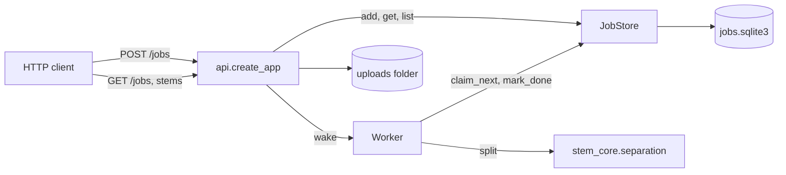

# Execution Plan - Add the HTTP API

> Every requirement traces to a user story in the confirmed design.

**Skill:** [plan](../../ravintio-zero/skills/ravintio-plan/SKILL.md)
**Feature:** 0000010-http-api
**Version:** 0.5.0
**Status:** active

## Active Skills

| Skill | Scope | Purpose |
|-------|-------|---------|
| ravintio-implement | plan | Builds each unit with tests and docs |

## Functional Requirements Directory

Functional requirements are split into individual files, one user story per file, at `plan/current/requirements/`.

| File | Requirement |
|------|------------|
| [req-001-upload.md](requirements/req-001-upload.md) | Upload an audio file and queue a job |
| [req-002-job-status.md](requirements/req-002-job-status.md) | Read one job or the list of jobs |
| [req-003-stem-download.md](requirements/req-003-stem-download.md) | Download each stem of a finished job as WAV |
| [req-004-safe-defaults.md](requirements/req-004-safe-defaults.md) | Bind to `127.0.0.1`, create folders, run a worker, and complete a job |

## Non-Functional Requirements

| ID | Category | Requirement | Target | Measurement |
|----|----------|------------|--------|-------------|
| NFR-001 | Exposure | The service binds to the loopback address unless the operator sets `STEMS_HOST` | Default host `127.0.0.1` | A unit test reads `resolve_host()` |
| NFR-002 | Upload limit | An upload above the limit leaves no job and no file | Status 413 and zero files under `uploads` | A unit test with a limit of 10 bytes |
| NFR-003 | Path safety | A stem request outside the job's outputs serves no file | Status 404 for `..` and unlisted names | A unit test sends both |

## API Summary

Four routes: `POST /jobs`, `GET /jobs`, `GET /jobs/{id}`, and `GET /jobs/{id}/stems/{name}`. See `plan/current/openapi-spec.yaml`. The routes have no version prefix and no login.

## Data Model Summary

No new table. The API reads and writes the `jobs` table through `JobStore`. It also writes uploads to `{data_dir}/uploads/{random id}/{file name}`. `stem-service` owns both. See `src/stem-service/docs/data-contract.md`.

## Component Interactions

## Test impact

| Cause | Test | Unit |
|-------|------|------|
| Backlog entry id | The `test-*` suites that name `0000011` do so for pack reasons that do not touch this entry | U1-upload |
| Workflow job or step edit | `src/stem-core/tests/test_pin_ci.py` asserts the text `.[dev,separation]` in the python job. `src/stem-core/tests/test_ci_job.py` reads the same job. The step updates the first | U3-entry |
| New test file | `test-0000042-req-008-pack-prose.sh`, `test-0000164-req-008-no-process-substitution-loops.sh` | U1-upload |
| New tracked file | `test-0000042-req-010-pack-wording-allowlist.sh` | U4-docs |
| Pyproject edit | `src/stem-core/tests/test_entry_points.py` reads `pyproject.toml` for the `stems` script and the package list. The step keeps both | U3-entry |
| Skill count, skill-text budget, size cap, reference file edit, non-suite file, fixture-pinned line | none found | none |

## Branch-point reads

| File | Commit read | Unit |
|------|-------------|------|
| `src/stem-service/stem_service/config.py` | `80f5ad7` | U1-upload |
| `src/stem-service/stem_service/api.py`, `__main__.py` | new | U1-upload, U3-entry |
| `src/stem-service/tests/test_api_upload.py`, `test_api_read.py`, `test_api_service.py` | new | U1-upload, U2-read, U3-entry |
| `pyproject.toml` | `522f35a` | U3-entry |
| `.github/workflows/ravintio.yml` | `c8398e0` | U3-entry |
| `src/stem-core/tests/test_pin_ci.py` | `c8398e0` | U3-entry |
| `src/stem-service/component.yml` | `80f5ad7` | U4-docs |
| `src/stem-service/docs/` (seven files) | `80f5ad7` | U4-docs |
| `docs/component-registry.md`, `docs/dependency-graph.md`, `docs/architecture-overview.md`, `docs/decisions-index.md` | `80f5ad7` | U4-docs |

## Concurrency plan

| Unit | Depends on | Writes | Batch | Sequential reason | Shared resources |
|------|-----------|--------|-------|-------------------|------------------|
| U1-upload | none | `src/stem-service/stem_service/config.py`, `src/stem-service/stem_service/api.py`, `src/stem-service/tests/test_api_upload.py` | 1 | The later routes extend the file that this unit creates | none |
| U2-read | U1-upload | `src/stem-service/stem_service/api.py`, `src/stem-service/tests/test_api_read.py` | 2 | Edits the same module as U1 | none |
| U3-entry | U2-read | `src/stem-service/stem_service/__main__.py`, `src/stem-service/tests/test_api_service.py`, `pyproject.toml`, `.github/workflows/ravintio.yml`, `src/stem-core/tests/test_pin_ci.py` | 3 | The end-to-end test needs every route | none |
| U4-docs | U3-entry | `src/stem-service/component.yml`, the `docs/` set of `stem-service`, `docs/component-registry.md`, `docs/dependency-graph.md`, `docs/architecture-overview.md`, `docs/decisions-index.md` | 4 | Describes the finished code | none |

## Assumptions

| ID | Assumption | Impact if Wrong |
|----|-----------|----------------|
| A-001 | The service trusts a caller on the same host | An open upload route on a shared host |
| A-002 | Every finished job lists WAV paths in `outputs` | A stem downloads with the wrong media type |

## Open Questions

None.
