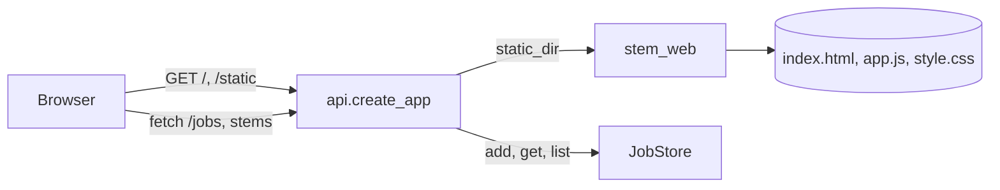

# Execution Plan - Add the web front end

> Every requirement traces to a user story in the confirmed design.

**Skill:** [plan](../../ravintio-zero/skills/ravintio-plan/SKILL.md)
**Feature:** 0000012-web-front-end
**Version:** 0.6.0
**Status:** active

## Active Skills

| Skill | Scope | Purpose |
|-------|-------|---------|
| ravintio-implement | plan | Builds each unit with tests and docs |

## Functional Requirements Directory

Functional requirements are split into individual files, one user story per file, at `plan/current/requirements/`.

| File | Requirement |
|------|------------|
| [req-001-serve-page.md](requirements/req-001-serve-page.md) | Serve the page at `/` and its files under `/static` |
| [req-002-upload-form.md](requirements/req-002-upload-form.md) | Send a chosen file and the full stems option to `POST /jobs` |
| [req-003-job-progress.md](requirements/req-003-job-progress.md) | List jobs and poll until each reaches `done` or `failed` |
| [req-004-stem-results.md](requirements/req-004-stem-results.md) | Show one player and one download link per stem of a `done` job |

## Non-Functional Requirements

| ID | Category | Requirement | Target | Measurement |
|----|----------|------------|--------|-------------|
| NFR-001 | Safe rendering | The script writes server text with `textContent` only | Zero uses of `innerHTML` in `app.js` | A unit test reads the script |
| NFR-002 | Path safety | `/static` serves files from the page folder only | Status 404 for `..` paths | A unit test requests them |
| NFR-003 | No build | The service serves the files as they sit in the repo | Three files answer 200 | A unit test fetches each file |

## API Summary

Two new routes: `GET /` and `GET /static/{file}`. See `plan/current/openapi-spec.yaml`. The page calls the four job routes from step 5 and adds no other route.

## Data Model Summary

No new table and no new data. `stem-web` owns no data. The page reads jobs through `GET /jobs`.

## Component Interactions

## Test impact

| Cause | Test | Unit |
|-------|------|------|
| Backlog entry id | `ravintio-zero/tests/test-0000321-req-002-index-generator.sh` names `0000013` in a temporary fixture repo. It reads no real entry, so the pull-in does not touch it | U1-serve |
| Workflow job or step edit | none found. The step edits no workflow file | none |
| New test file | `test-0000042-req-008-pack-prose.sh`, `test-0000164-req-008-no-process-substitution-loops.sh` | U1-serve |
| New tracked file | `test-0000042-req-010-pack-wording-allowlist.sh` | U4-docs |
| Pyproject edit | none found. The step edits no `pyproject.toml` | none |
| Existing Python tests | `src/stem-service/tests/test_api_*.py` call `create_app()`. The new route and mount must not change their answers | U1-serve |
| Skill count, skill-text budget, size cap, reference file edit, non-suite file, fixture-pinned line | none found | none |

## Branch-point reads

| File | Commit read | Unit |
|------|-------------|------|
| `src/stem-service/stem_service/api.py` | `2348ddf` | U1-serve |
| `src/stem-web/stem_web/__init__.py` | `a4aed6b` | U1-serve |
| `src/stem-web/stem_web/static/index.html`, `app.js`, `style.css` | new | U1-serve, U2-script, U3-stems |
| `src/stem-web/tests/test_page_serve.py`, `test_page_script.py`, `test_stem_links.py` | new | U1-serve, U2-script, U3-stems |
| `src/stem-web/component.yml` | `a4aed6b` | U4-docs |
| `src/stem-service/component.yml` | `2348ddf` | U4-docs |
| `src/stem-web/docs/` (five files) | `a4aed6b` | U4-docs |
| `src/stem-service/docs/interface-contract.md`, `dependencies.md` | `2348ddf` | U4-docs |
| `docs/component-registry.md`, `docs/dependency-graph.md`, `docs/architecture-overview.md`, `docs/decisions-index.md` | `2348ddf` | U4-docs |

## Concurrency plan

| Unit | Depends on | Writes | Batch | Sequential reason | Shared resources |
|------|-----------|--------|-------|-------------------|------------------|
| U1-serve | none | `src/stem-web/stem_web/__init__.py`, `src/stem-web/stem_web/static/index.html`, `src/stem-web/stem_web/static/app.js`, `src/stem-web/stem_web/static/style.css`, `src/stem-service/stem_service/api.py`, `src/stem-web/tests/test_page_serve.py` | 1 | The later units extend the files that this unit creates | none |
| U2-script | U1-serve | `src/stem-web/stem_web/static/index.html`, `src/stem-web/stem_web/static/app.js`, `src/stem-web/stem_web/static/style.css`, `src/stem-web/tests/test_page_script.py` | 2 | Edits the same files as U1 | none |
| U3-stems | U2-script | `src/stem-web/stem_web/static/app.js`, `src/stem-web/tests/test_stem_links.py` | 3 | Edits the same script as U2 | none |
| U4-docs | U3-stems | `src/stem-web/component.yml`, `src/stem-service/component.yml`, the `docs/` sets of both components, `docs/component-registry.md`, `docs/dependency-graph.md`, `docs/architecture-overview.md`, `docs/decisions-index.md` | 4 | Describes the finished code | none |

## Assumptions

| ID | Assumption | Impact if Wrong |
|----|-----------|----------------|
| A-001 | The user reaches the page on the loopback address or through a trusted tunnel | An exposed service gives anyone the upload form |
| A-002 | A `done` job lists WAV stem names in `stems` | A player cannot decode a stem |

## Open Questions

None.
