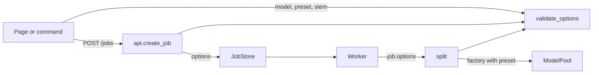

# Execution Plan - Add model choice and ensemble options

> Every requirement traces to a user story in the confirmed design.

**Skill:** [plan](../../ravintio-zero/skills/ravintio-plan/SKILL.md)
**Feature:** 0000014-model-ensemble-options
**Version:** 0.7.0
**Status:** active

## Active Skills

| Skill | Scope | Purpose |
|-------|-------|---------|
| ravintio-implement | plan | Builds each unit with tests and docs |

## Functional Requirements Directory

Functional requirements are split into individual files, one user story per file, at `plan/current/requirements/`.

| File | Requirement |
|------|------------|
| [req-001-split-options.md](requirements/req-001-split-options.md) | Pass a pass 2 model, a preset, and a single stem to `split()`, and reject any value outside the allowlists |
| [req-002-command-options.md](requirements/req-002-command-options.md) | Pass the same options to `stems split`, and list the allowed values |
| [req-003-api-options.md](requirements/req-003-api-options.md) | Accept the options on `POST /jobs`, store them, and pass them to `split()` |
| [req-004-page-options.md](requirements/req-004-page-options.md) | Choose the options on the upload form |

## Non-Functional Requirements

| ID | Category | Requirement | Target | Measurement |
|----|----------|------------|--------|-------------|
| NFR-001 | Fail before load | A job that names an unlisted option fails before any model loads | Zero `load_model` calls for a bad value | A unit test counts the calls on a fake separator |
| NFR-002 | Clear error | The error names the option, the bad value, and the allowed values | One line that holds all three | A unit test reads the message |

## API Summary

No new route. `POST /jobs` gains three optional form fields and the status 422. See `plan/current/openapi-spec.yaml`.

## Data Model Summary

No new table and no new column. The job store already writes `jobs.options` as a JSON object. This step stores the set options there. `stem-service` keeps ownership of the table.

## Component Interactions

## Test impact

| Cause | Test | Unit |
|-------|------|------|
| Backlog entry id | `test-0000481-req-001-regenerate.sh`, `test-0000456-req-001-shared-files.sh`, and `test-0000456-req-001-queue-resolves.sh` name `0000015` in temporary fixture repos. They read no real entry, so the pull-in does not touch them | U1-core |
| Workflow job or step edit | none found. The step edits no workflow file | none |
| New test file | `test-0000042-req-008-pack-prose.sh`, `test-0000164-req-008-no-process-substitution-loops.sh` | U1-core |
| New tracked file | `test-0000042-req-010-pack-wording-allowlist.sh` | U5-docs |
| Existing Python tests | `src/stem-core/tests/test_separation.py` and `test_cli.py` call `split()` and `cli.main()` with three-argument factories and no option. `src/stem-service/tests/test_worker.py` uses four-argument fake `split` functions. All must still pass | U1-core, U2-cli, U3-service |
| Existing models listing | `src/stem-core/tests/test_cli.py` reads the `stems models` output. The new lines come after the two existing ones | U2-cli |
| Skill count, skill-text budget, size cap, reference file edit, non-suite file, fixture-pinned line | none found | none |

## Branch-point reads

| File | Commit read | Unit |
|------|-------------|------|
| `src/stem-core/stem_core/separation.py` | `c8398e0` | U1-core |
| `src/stem-core/stem_core/cli.py` | `522f35a` | U2-cli |
| `src/stem-service/stem_service/api.py` | `c5d2ce2` | U3-service |
| `src/stem-service/stem_service/worker.py` | `80f5ad7` | U3-service |
| `src/stem-web/stem_web/static/index.html`, `app.js` | `c5d2ce2` | U4-page |
| `src/stem-core/tests/test_options.py`, `test_cli_options.py` | new | U1-core, U2-cli |
| `src/stem-service/tests/test_api_options.py`, `test_worker_options.py` | new | U3-service |
| `src/stem-web/tests/test_page_options.py` | new | U4-page |
| `src/*/component.yml`, `src/*/docs/` | `c5d2ce2` | U5-docs |
| `docs/component-registry.md`, `docs/dependency-graph.md`, `docs/architecture-overview.md`, `docs/decisions-index.md` | `c5d2ce2` | U5-docs |

## Concurrency plan

| Unit | Depends on | Writes | Batch | Sequential reason | Shared resources |
|------|-----------|--------|-------|-------------------|------------------|
| U1-core | none | `src/stem-core/stem_core/separation.py`, `src/stem-core/tests/test_options.py` | 1 | The later units import the allowlists | none |
| U2-cli | U1-core | `src/stem-core/stem_core/cli.py`, `src/stem-core/tests/test_cli_options.py` | 2 | Needs the allowlists | none |
| U3-service | U1-core | `src/stem-service/stem_service/api.py`, `src/stem-service/stem_service/worker.py`, `src/stem-service/tests/test_api_options.py`, `src/stem-service/tests/test_worker_options.py` | 3 | The inline run keeps one writer for the pytest cache | none |
| U4-page | U3-service | `src/stem-web/stem_web/static/index.html`, `src/stem-web/stem_web/static/app.js`, `src/stem-web/tests/test_page_options.py` | 4 | The page posts to the fields that U3 adds | none |
| U5-docs | U4-page | `src/stem-core/component.yml`, `src/stem-service/component.yml`, `src/stem-web/component.yml`, the `docs/` sets of the three components, `docs/component-registry.md`, `docs/dependency-graph.md`, `docs/architecture-overview.md`, `docs/decisions-index.md`, `docs/adr/0007-allowlisted-model-options-in-stem-core.md` | 5 | Describes the finished code | none |

## Assumptions

| ID | Assumption | Impact if Wrong |
|----|-----------|----------------|
| A-001 | The preset names match `audio-separator` 0.48.0 | A preset fails inside the engine and the job ends `failed` |
| A-002 | An ensemble pass 1 still writes vocals and instrumental files | Pass 1 raises the error that names the missing file |

## Open Questions

None.
