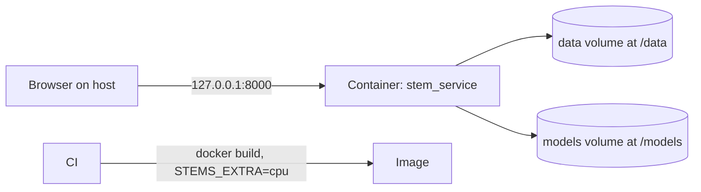

# Execution Plan - Add the Docker image and compose file

> Every requirement traces to a user story in the confirmed design.

**Skill:** [plan](../../ravintio-zero/skills/ravintio-plan/SKILL.md)
**Feature:** 0000016-docker-packaging
**Version:** 0.8.0
**Status:** active

## Active Skills

| Skill | Scope | Purpose |
|-------|-------|---------|
| ravintio-implement | plan | Builds each unit with tests and docs |

## Functional Requirements Directory

Functional requirements are split into individual files, one user story per file, at `plan/current/requirements/`.

| File | Requirement |
|------|------------|
| [req-001-docker-image.md](requirements/req-001-docker-image.md) | Build one image with Python 3.12, FFmpeg, and the service, with a build argument for the CPU or GPU extra |
| [req-002-compose-file.md](requirements/req-002-compose-file.md) | Run the stack with `docker compose up`, two named volumes, and a loopback port |
| [req-003-ci-image-build.md](requirements/req-003-ci-image-build.md) | Build the CPU image in CI on every pull request |

## Non-Functional Requirements

| ID | Category | Requirement | Target | Measurement |
|----|----------|------------|--------|-------------|
| NFR-001 | Security | The compose file publishes the port on the loopback address only | The host side of the port line starts with `127.0.0.1` | A unit test reads the line |
| NFR-002 | Persistence | A restart keeps the models and the finished jobs | Both volumes survive `docker compose down` and `up` | A local run restarts the stack and lists the job |

## API Summary

No API change. The container serves the existing routes on port 8000.

## Data Model Summary

No new table and no new column. The data volume holds the SQLite file. `stem-service` keeps ownership of the `jobs` table.

## Component Interactions

## Test impact

| Cause | Test | Unit |
|-------|------|------|
| Workflow job or step edit | `test-0000390-req-003-enforcement-points.sh`, `test-0000317-req-001-003-004-rules-ignores-checks.sh`, and `test-0000327-req-002-ci-job.sh` read `.github/workflows/ravintio.yml` for named steps. A new job removes none of them | U3-ci |
| Backlog entry id | The tests that name `0000017` belong to the pack and read no real entry. The pull-in of entry 0000017 touches none of them | U1-image |
| New test file | `test-0000042-req-008-pack-prose.sh`, `test-0000164-req-008-no-process-substitution-loops.sh` | U1-image |
| New tracked file | `test-0000042-req-010-pack-wording-allowlist.sh` | U4-docs |
| Existing Python tests | `src/stem-service/tests/test_smoke.py` and the API tests build the app in process. The Dockerfile changes none of them | U1-image |
| Skill count, skill-text budget, size cap, reference file edit, non-suite file, fixture-pinned line | none found | none |

## Branch-point reads

| File | Commit read | Unit |
|------|-------------|------|
| `.github/workflows/ravintio.yml` | `7ee0df7` | U3-ci |
| `pyproject.toml` | `7ee0df7` | U1-image |
| `Dockerfile`, `.dockerignore`, `compose.yaml`, `compose.gpu.yaml` | new | U1-image, U2-compose |
| `src/stem-service/tests/test_docker_image.py`, `test_compose.py`, `test_ci_docker.py` | new | U1-image, U2-compose, U3-ci |
| `src/stem-service/component.yml`, `src/stem-service/docs/` | `7ee0df7` | U4-docs |
| `docs/component-registry.md`, `docs/dependency-graph.md`, `docs/architecture-overview.md`, `docs/decisions-index.md` | `7ee0df7` | U4-docs |

## Concurrency plan

| Unit | Depends on | Writes | Batch | Sequential reason | Shared resources |
|------|-----------|--------|-------|-------------------|------------------|
| U1-image | none | `Dockerfile`, `.dockerignore`, `src/stem-service/tests/test_docker_image.py` | 1 | The compose file builds this image | none |
| U2-compose | U1-image | `compose.yaml`, `compose.gpu.yaml`, `src/stem-service/tests/test_compose.py` | 2 | Builds the image from U1 | none |
| U3-ci | U1-image | `.github/workflows/ravintio.yml`, `src/stem-service/tests/test_ci_docker.py` | 2 | none | none |
| U4-docs | U3-ci | `src/stem-service/component.yml`, `src/stem-service/docs/`, `docs/component-registry.md`, `docs/dependency-graph.md`, `docs/architecture-overview.md`, `docs/decisions-index.md`, `docs/adr/0008-docker-packaging-of-the-service.md` | 3 | Describes the finished files | none |

## Assumptions

| ID | Assumption | Impact if Wrong |
|----|-----------|----------------|
| A-001 | The NVIDIA container toolkit is present on a GPU host | The GPU job fails at its first run with the engine's error |
| A-002 | `python:3.12-slim` installs the `audio-separator[cpu]` wheels | The CI build fails and the step reports it |

## Open Questions

None.
