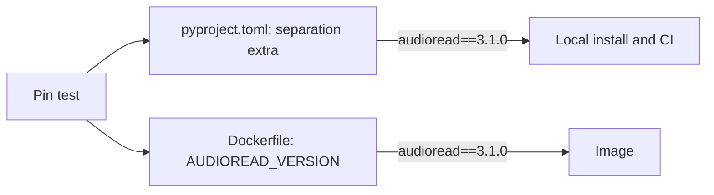

# Execution Plan - Add audioread to the image and the separation extra

> Every requirement traces to a user story in the confirmed design.

**Skill:** [plan](../../ravintio-zero/skills/ravintio-plan/SKILL.md)
**Feature:** 0000029-add-audioread
**Version:** 0.8.1
**Status:** active

## Active Skills

| Skill | Scope | Purpose |
|-------|-------|---------|
| ravintio-implement | plan | Builds each unit with tests and docs |

## Functional Requirements Directory

Functional requirements are split into individual files, one user story per file, at `plan/current/requirements/`.

| File | Requirement |
|------|------------|
| [req-001-pinned-audioread.md](requirements/req-001-pinned-audioread.md) | Install `audioread` at one pinned version in the `separation` extra and in the image |
| [req-002-fresh-image-job.md](requirements/req-002-fresh-image-job.md) | Finish a job in a fresh image with no manual install |

## Non-Functional Requirements

| ID | Category | Requirement | Target | Measurement |
|----|----------|------------|--------|-------------|
| NFR-001 | Maintainability | The `Dockerfile` and `pyproject.toml` name one `audioread` version | The two version strings are equal | A unit test compares them |

## API Summary

No API change.

## Data Model Summary

No new table and no new column.

## Component Interactions

## Test impact

| Cause | Test | Unit |
|-------|------|------|
| Backlog entry id | The pack tests that name `0000023` read no real entry. The pull-in of entry 0000023 touches none of them | U1-pin |
| Existing Python tests | `test_entry_points.py`, `test_pin_ci.py`, and `test_docker_image.py` match the engine pin by pattern. A second item after it breaks none of them | U1-pin |
| Existing Python tests | `src/stem-service/tests/test_docker_docs.py` reads the component docs. U2-docs reruns it | U2-docs |
| New tracked file | `test-0000042-req-010-pack-wording-allowlist.sh` reads each tracked file. It is an inherited failure in the baseline | U2-docs |
| New test file | none found. The run adds tests to existing files | none |
| Skill count, skill-text budget, size cap, workflow job or step edit, reference file edit, non-suite file, fixture-pinned line | none found | none |

## Branch-point reads

| File | Commit read | Unit |
|------|-------------|------|
| `pyproject.toml` | `2b863d9` | U1-pin |
| `Dockerfile` | `3b10800` | U1-pin |
| `src/stem-core/tests/test_pin_ci.py` | `2b863d9` | U1-pin |
| `src/stem-service/tests/test_docker_image.py` | `3b10800` | U1-pin |
| `src/stem-core/docs/dependencies.md` | `b0e8575` | U2-docs |
| `src/stem-core/docs/quirks.md` | `f508e97` | U2-docs |
| `src/stem-service/docs/dependencies.md`, `src/stem-service/docs/quirks.md`, `src/stem-service/component.yml` | `3b10800` | U2-docs |
| `docs/architecture-overview.md`, `docs/decisions-index.md` | `3b10800` | U2-docs |
| `docs/adr/0009-pin-audioread-beside-the-engine.md` | new | U2-docs |

## Concurrency plan

| Unit | Depends on | Writes | Batch | Sequential reason | Shared resources |
|------|-----------|--------|-------|-------------------|------------------|
| U1-pin | none | `pyproject.toml`, `Dockerfile`, `src/stem-core/tests/test_pin_ci.py`, `src/stem-service/tests/test_docker_image.py` | 1 | The docs describe these files | none |
| U2-docs | U1-pin | `src/stem-core/docs/dependencies.md`, `src/stem-core/docs/quirks.md`, `src/stem-service/docs/dependencies.md`, `src/stem-service/docs/quirks.md`, `src/stem-service/component.yml`, `src/stem-service/tests/test_docker_docs.py`, `docs/architecture-overview.md`, `docs/decisions-index.md`, `docs/adr/0009-pin-audioread-beside-the-engine.md` | 2 | Describes the finished files | none |

## Assumptions

| ID | Assumption | Impact if Wrong |
|----|-----------|----------------|
| A-001 | `audioread` 3.1.0 works with `audio-separator` 0.48.0 on Python 3.12 | The hand-run job fails, and the run stops with the engine's error |

## Open Questions

None.
